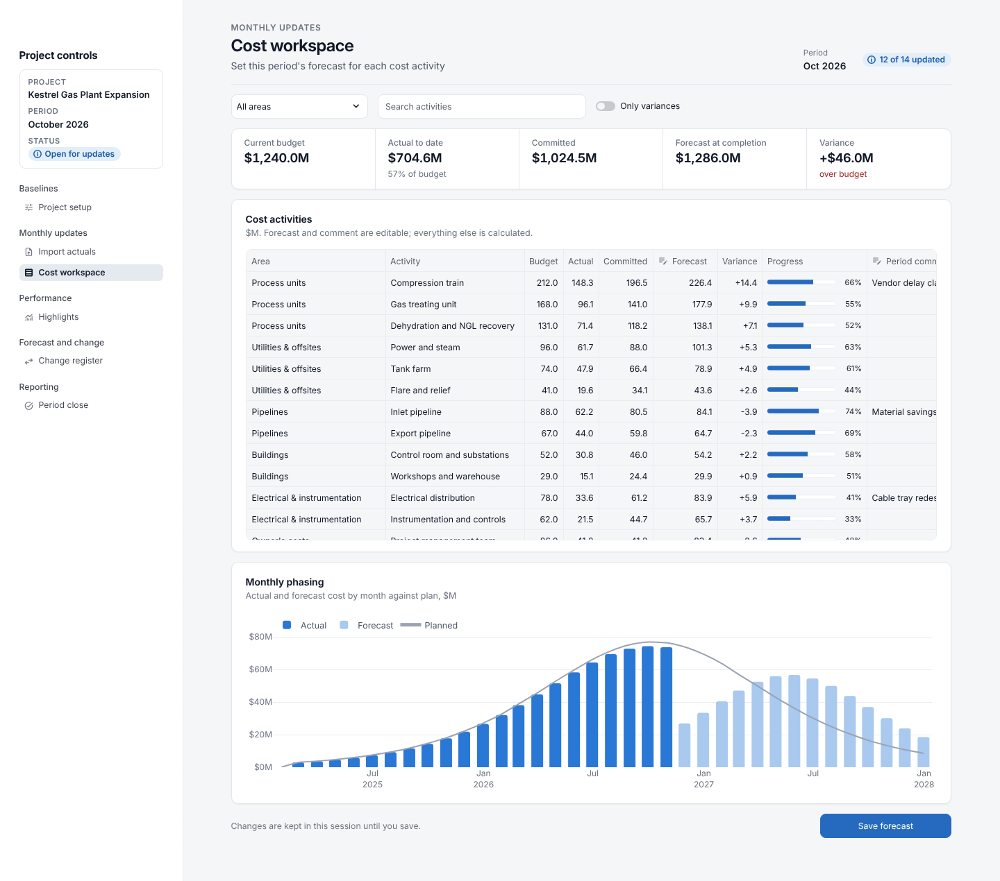
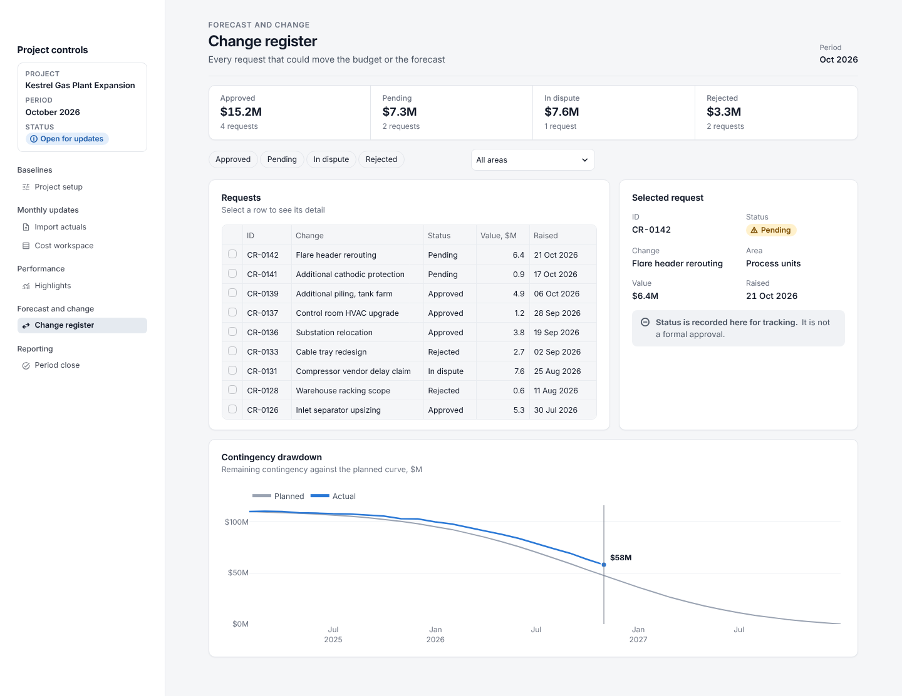
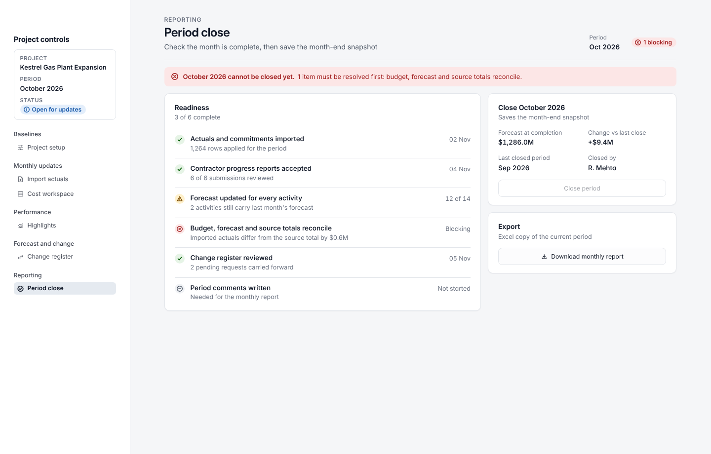

# Streamlit app design skill for GitHub Copilot

A design system Copilot can follow so Streamlit apps — especially project controls
tools (cost, schedule, earned value, forecast, change, monthly reporting) — come out
consistent and polished instead of default-looking.

It covers the whole app, not only dashboards: a sidebar shell plus seven page types
(dashboard, workspace with an editable grid, form, stepped task such as an import,
register, checklist and close, reference).

| Dashboard | Workspace |
|---|---|
|  |  |

| Register | Checklist and close |
|---|---|
|  |  |

## What is here

```
.github/
  skills/streamlit-dashboard-design/
    SKILL.md                     the instructions Copilot loads
    references/                  page types; design tokens; project controls patterns
    scripts/install.py           copies the kit into a project
    assets/
      ui_kit/                    app shell, components, tables + Plotly chart recipes (Python)
      streamlit/config.toml      theme (fonts, colours, light + dark)
      static/InterVariable.woff2 bundled font (SIL Open Font License)
      example/                   reference app (one page per type), made-up data, previews
  instructions/
    streamlit-design.instructions.md   fallback pointer for Copilot
```

All sample data is synthetic.

## Set up

Use it in this repository, or copy the whole `.github/` folder to the root of the
repository that holds your Streamlit app. Then, from that repository's root:

1. Install the kit:
   `python .github/skills/streamlit-dashboard-design/scripts/install.py`
   This adds `ui_kit/`, `.streamlit/config.toml` and `static/` to the project and
   never overwrites existing files. After pulling a newer version of this skill,
   run it again with `--update` to refresh `ui_kit/`.
2. See the reference app: copy `app.py`, `sample_data.py` and the `views/` folder
   from `.github/skills/streamlit-dashboard-design/assets/example/` to the repository
   root, then run `streamlit run app.py`.
3. Requirements: `streamlit` 1.46 or newer (built on 1.67), `plotly`, `pandas`.

## Use it in Copilot

Use Copilot Chat in **Agent** mode. The skill loads on its own when you ask for
Streamlit UI work; naming it removes any doubt:

> Use the streamlit-dashboard-design skill. Build the cost workspace page as a
> Workspace page type from `data/cost.py`. Plan the page first, then build it.

To restyle an existing app, one page at a time:

> Use the streamlit-dashboard-design skill. Set up the app shell in `app.py`, then
> rebuild the import page as a Stepped task page with `ui_kit`. Keep the data logic
> unchanged and run the checklist at the end.

If agent skills are switched off in your organisation, the file in
`.github/instructions/` still points Copilot to the same guidance whenever it edits
Python files.

## Make it yours

- Brand colour, fonts, series colours: see
  `.github/skills/streamlit-dashboard-design/references/design-system.md` ("Rebranding").
- Status thresholds and KPI definitions:
  `.github/skills/streamlit-dashboard-design/references/project-controls-patterns.md`
  lists common defaults; edit them to match your project's rules.
